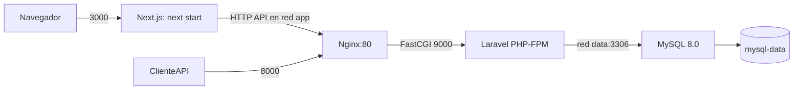

# Laboratorio: imágenes eficientes con Docker

NORTE reutiliza el frontend Next.js 16 App Router y la API Laravel 12 del bootcamp. Esta entrega agrega imágenes multi-stage y MySQL 8.0. El README conserva las instrucciones de la actividad anterior para ejecución local con SQLite.

## Arquitectura



Cuatro contenedores permanentes representan tres servicios funcionales: frontend, API (Nginx + FPM) y base de datos. Un quinto contenedor temporal, `migrate`, aplica migraciones antes de iniciar la API. MySQL no publica puertos y pertenece a una red interna; PHP conserva salida a internet por la red app para Stripe. Las peticiones del navegador pasan por Server Actions y Server Components de Next.js; `BASE_URL=http://api/api` se resuelve dentro de Docker.

## Preparación y ejecución

Requiere Docker Desktop iniciado con contenedores Linux y Docker Compose moderno. No hace falta instalar PHP, Node ni Composer en el host.

1. Copiar `.env.example` a `.env` (PowerShell: `Copy-Item .env.example .env`; Linux/macOS: `cp .env.example .env`).
2. Completar `MYSQL_ROOT_PASSWORD` y `MYSQL_PASSWORD` con contraseñas distintas. Para valores con `$`, usar comillas simples en el archivo `.env`.
3. Generar una clave una sola vez:

```sh
docker compose build backend
docker compose run --rm --no-deps --entrypoint php -e APP_KEY= backend artisan key:generate --show
```

Durante la generación Compose exige un valor provisional no vacío de `APP_KEY` en `.env`, por ejemplo `temporal`. Reemplazarlo después por la salida `base64:...` del comando. No cambiar esta clave al reiniciar ni compartir `.env`.

4. Levantar el ecosistema:

```sh
docker compose up --build -d
docker compose exec backend php artisan db:seed --force
docker compose ps -a
```

Las migraciones son automáticas; el seeder del catálogo se ejecuta explícitamente una vez. Usa `firstOrCreate`, por lo que puede repetirse sin duplicar productos existentes. Los siguientes arranques usan `docker compose up -d`.

- Tienda: http://localhost:3000
- API: http://localhost:8000/api/products
- Salud Laravel: http://localhost:8000/up
- Swagger: http://localhost:8000/docs

El catálogo y el registro funcionan sin Stripe. Los pagos necesitan claves de prueba en `STRIPE_SECRET` y `STRIPE_WEBHOOK_SECRET`, y el reenvío del webhook explicado en README. Los cambios de entorno requieren `docker compose up -d --force-recreate`. Para un dominio público, configurar `SITE_URL`, `API_URL` y HTTPS mediante un proxy de entrada. Las cookies de producción son Secure; para pruebas locales usar `localhost` en el navegador, no una IP de la LAN.

## Decisiones de las imágenes

### Frontend

`dependencies` instala con pnpm 11.25.0 y lockfile congelado; el manifiesto se copia antes del código para reutilizar la capa. La caché BuildKit guarda las descargas. `build` ejecuta `next build --webpack`. `production-dependencies` elimina dependencias de desarrollo con `CI=true pnpm prune --prod` para funcionar sin confirmaciones interactivas en Docker. `runtime` copia `.next`, `public`, configuración JavaScript y dependencias de producción; ejecuta `next start` con el usuario `node` y expone 3000. La configuración usa `.mjs` para evitar instalar TypeScript en ejecución. No se usa standalone porque la consigna solicita `next start`. Se conserva la caché de Next escribible para ISR.

Se utiliza Node 24 Alpine, compatible con el proyecto y superior al mínimo requerido; Node 20 de la consigna es una recomendación. `.dockerignore` excluye secretos, módulos locales, backend, evidencias y artefactos.

### Backend

`php-base` usa PHP 8.4 FPM Alpine porque `composer.json` exige `^8.4` (cumple 8.2+). Compila `pdo_mysql`, `mbstring` y `xml`; elimina compiladores en la misma capa y mantiene bibliotecas de ejecución. OpenSSL, tokenizer, ctype y JSON están incluidos en PHP de la imagen oficial. La etapa `dependencies` instala Composer con `--no-dev`, sin scripts que dependan del código ausente, y genera un autoloader optimizado después de copiar las clases.

Del constructor se copia únicamente `vendor/` al runtime, además del código de la aplicación copiado desde el contexto. Composer y sus cachés no llegan a producción. Laravel necesita también `app`, `bootstrap`, `config`, `database`, `public`, `routes` y `artisan`: copiar únicamente vendor como contenido total impediría ejecutar la API. Se ejecuta como `www-data`; solo storage y bootstrap/cache son escribibles. El entrypoint descubre paquetes y genera la caché de configuración con variables de ejecución, sin incluir secretos en las capas.

El target `web` usa Nginx y copia exclusivamente archivos públicos. Solo `index.php` se envía a PHP-FPM; el puerto 9000 no se publica. Nginx inicia su proceso maestro con el comportamiento estándar de la imagen oficial y sus workers atienden las peticiones.

### MySQL

Se utiliza directamente `mysql:8.0`: no se fabrica un Dockerfile sin cambios útiles. El volumen nombrado persiste `/var/lib/mysql`; Laravel utiliza una cuenta limitada a su base. La comprobación de salud ejecuta SQL con esa cuenta antes de permitir las migraciones. Las contraseñas de inicialización solo se aplican al crear un volumen vacío: cambiarlas en `.env` no actualiza usuarios existentes.

Los lockfiles fijan dependencias de aplicación. Las etiquetas base reciben actualizaciones y no son inmutables: para reproducibilidad binaria estricta, fijar sus digest SHA256 tras construir y verificar en el entorno de entrega.

## Verificación y evidencia para entregar

```sh
docker compose config --quiet
docker compose up --build -d
docker compose exec backend php artisan db:seed --force
docker compose ps -a
curl http://localhost:8000/up
curl http://localhost:8000/api/products
curl http://localhost:3000/api/session
docker compose exec backend php -m
docker compose exec backend php artisan migrate:status
docker compose exec backend php artisan db:show
docker image ls norte-frontend norte-api norte-nginx
docker compose logs --tail=50
```

Usar `curl.exe` en PowerShell si `curl` es un alias. Comprobar registro/login desde la tienda y repetir después de `docker compose down` y `docker compose up -d` para verificar persistencia. `migrate` debe terminar con código 0; los demás servicios deben seguir activos. En `php -m` verificar las siete extensiones solicitadas; MySQL no debe mostrar un puerto del host en `ps`.

Para medir caché, ejecutar dos veces `docker compose build --progress plain` y registrar duración y pasos `CACHED`. Modificar solo código debe reutilizar la instalación de dependencias. Para comparar tamaño con una imagen anterior usar `docker image inspect IMAGEN --format '{{.Size}}'` y `docker history IMAGEN`; no inventar porcentajes sin medir ambas imágenes. Guardar capturas de los comandos, la tienda y las respuestas de API como evidencia del laboratorio.

Detener con `docker compose down` conserva los datos. `docker compose down -v` elimina permanentemente la base; usarlo únicamente si se desea reiniciar el laboratorio.

## Validación realizada en esta preparación

El 8 de noviembre de 2026 pasaron `docker compose config --quiet` (con variables provisionales de validación), `pnpm test` (3 pruebas), `pnpm typecheck`, `pnpm build` y PHPUnit (4 pruebas, 6 aserciones). También pasó la revisión de sintaxis PHP de la configuración de base de datos. Las pruebas PHP existentes utilizan SQLite en memoria; no sustituyen una prueba de integración con MySQL.

El 13 de noviembre de 2026 se construyeron y ejecutaron las imágenes con Docker Desktop. Pasaron las migraciones en MySQL, las siete extensiones PHP solicitadas, las 14 comprobaciones HTTP de la API y el registro desde el navegador. Después de `docker compose down` y `docker compose up -d` se conservaron seis productos, tres usuarios, una orden y la sesión del navegador. La reconstrucción sin cambios tardó 10,41 segundos y registró 35 pasos CACHED. Tamaños locales reportados por Docker: frontend 707.557.371 bytes, Laravel 189.819.194 bytes, Nginx 92.725.604 bytes y MySQL 1.085.694.697 bytes. Estos valores no representan tamaños comprimidos de descarga. Consulta [el informe y las capturas](evidencias/docker-verificacion.md). Los pagos de Stripe quedan fuera de esta verificación de Docker.

## Publicación

Repositorio público para entregar: [JoseCas3/norte-ecommerce](https://github.com/JoseCas3/norte-ecommerce). Incluye el frontend, la API Laravel, Dockerfiles, Compose, ejemplos de entorno y documentación. Las claves locales se excluyen del repositorio.

## Referencias

- [Builds multi-stage de Docker](https://docs.docker.com/build/building/multi-stage/)
- [Optimización de caché](https://docs.docker.com/build/cache/optimize/)
- [Despliegue Next.js](https://nextjs.org/docs/app/getting-started/deploying)
- [Imagen oficial PHP](https://hub.docker.com/_/php)
- [Imagen oficial MySQL](https://hub.docker.com/_/mysql)


---

# NORTE — E-commerce con Next.js 16 y Laravel 12

Actividad evaluada: **Optimización avanzada de rendimiento, Web Vitals y mutaciones asíncronas en el servidor**.

Frontend en Next.js App Router y TypeScript, API REST en Laravel 12, autenticación con Sanctum y pago con Stripe Checkout. El catálogo proviene de SQLite a través de la API; no hay un servidor simulado ni una alternativa de pagos ficticios.

## Requisitos

- Node.js 24 y pnpm 11.
- PHP 8.4 con extensiones curl, fileinfo, mbstring, openssl, pdo_sqlite, sqlite3 y zip.
- Composer 2.
- Stripe CLI y credenciales de un sandbox o cuenta de Stripe en modo de prueba.
- Edge, Chrome o Brave para ejecutar Lighthouse.

Se incluyen `pnpm-lock.yaml` y `backend/composer.lock`. En este equipo se prepararon binarios portátiles en `.tools/`; ese directorio es privado y no se distribuye en GitHub.

## Instalación y ejecución

Desde la raíz del proyecto:

```powershell
pnpm install --frozen-lockfile
./scripts/setup.ps1
```

El script crea los directorios de Laravel, copia los archivos de entorno si no existen, instala Composer, genera APP_KEY y ejecuta las migraciones y el seeder sin borrar datos existentes.

Abre tres terminales:

```powershell
# Terminal 1: API
./scripts/start-api.ps1

# Terminal 2: frontend
pnpm dev

# Terminal 3: webhooks de Stripe
./scripts/start-webhooks.ps1
```

- Tienda: [http://localhost:3000](http://localhost:3000).
- Swagger UI: [http://127.0.0.1:8000/docs](http://127.0.0.1:8000/docs).
- OpenAPI: [http://127.0.0.1:8000/openapi.json](http://127.0.0.1:8000/openapi.json).

En macOS/Linux, después de instalar las dependencias:

```sh
cp .env.example .env.local
cp backend/.env.example backend/.env
mkdir -p backend/bootstrap/cache backend/storage/framework/cache/data backend/storage/framework/sessions backend/storage/framework/views backend/storage/logs
touch backend/database/database.sqlite
cd backend
composer install
php artisan key:generate
php artisan migrate --seed
cd ..
php -S 127.0.0.1:8000 -t backend/public backend/server.php
# En otras terminales: pnpm dev y stripe listen ...
```

### Configuración del frontend: .env.local

```dotenv
BASE_URL=http://127.0.0.1:8000/api
SITE_URL=http://localhost:3000
```

`BASE_URL` es la URL base de Laravel e incluye `/api`. Solo se utiliza en el servidor. `SITE_URL` identifica la URL local de referencia; el retorno de Stripe se configura en `FRONTEND_URL` de Laravel.

### Configuración del backend: backend/.env

```dotenv
APP_NAME=NORTE
APP_ENV=local
APP_KEY=
APP_DEBUG=false
APP_URL=http://127.0.0.1:8000
FRONTEND_URL=http://localhost:3000
DB_CONNECTION=sqlite
STRIPE_SECRET=
STRIPE_WEBHOOK_SECRET=
```

`php artisan key:generate` completa APP_KEY. La base de datos se crea en `backend/database/database.sqlite`. Los precios se almacenan como enteros en centavos USD.

## Stripe: configuración y flujo de compra

1. Obtén una clave secreta de prueba de tu cuenta/sandbox y escríbela en `backend/.env`, en STRIPE_SECRET.
2. Ejecuta `stripe login` si usas una cuenta propia. Con un sandbox temporal, usa el perfil local creado por la CLI.
3. Inicia la escucha:

```sh
stripe listen --events checkout.session.completed,checkout.session.async_payment_succeeded,checkout.session.expired --forward-to http://127.0.0.1:8000/api/stripe/webhook
```

4. Copia el secreto `whsec_...` que muestra la CLI a STRIPE_WEBHOOK_SECRET. Mantén la escucha activa mientras pruebas.
5. Registra un usuario desde la tienda, agrega productos y continúa al pago.
6. En Checkout utiliza la tarjeta de prueba **4242 4242 4242 4242**, fecha futura y CVC de tres dígitos.
7. Comprueba la confirmación de compra y la orden con estado «Pago confirmado» en el historial.

Stripe procesa el pago en su infraestructura de pruebas; no se mueve dinero. La orden cambia a `paid` únicamente después de verificar una sesión pagada, su importe, moneda e identificador. El webhook exige firma válida. La página de retorno solo consulta la API.

**Sandbox preparado para esta entrega:** caduca el **9 de noviembre de 2026**. El enlace privado para reclamarlo está en `.tools/RECLAMAR-STRIPE.txt`, excluido de Git. Reclámalo antes de la fecha indicada para conservarlo. Las claves nunca deben adjuntarse a la entrega.

Referencias oficiales: [pruebas de Stripe](https://docs.stripe.com/testing), [confirmación de pagos](https://docs.stripe.com/checkout/fulfillment), [sandbox temporal](https://docs.stripe.com/cli/sandbox).

## Identidad visual

NORTE Daily Gear usa fondo azul medianoche, acentos azul eléctrico y rosa, tipografía sans serif y tarjetas de producto con ilustraciones SVG locales. El catálogo organiza las categorías en una barra lateral de escritorio y chips en pantallas pequeñas. El acceso usa una tarjeta central; carrito e historial mantienen el mismo sistema visual.

## Rutas implementadas

| Ruta                   | Acceso                     | Función                                      |
| ---------------------- | -------------------------- | -------------------------------------------- |
| /                      | Público                    | Redirige al catálogo                         |
| /catalogo              | Público                    | Listado, búsqueda y categorías               |
| /catalogo/[id]         | Público                    | Detalle, stock y agregar al carrito          |
| /registro              | Público                    | Registro mediante Server Action              |
| /login                 | Público                    | Login mediante Server Action                 |
| /checkout              | Público / pago autenticado | Carrito local y creación de orden            |
| /confirmacion?order=ID | Protegido                  | Estado real de una orden propia              |
| /historial             | Protegido                  | Órdenes del usuario y reanudación de pago    |
| /api/session           | Público                    | Indica si existe cookie sin exponer el token |

El proxy de Next.js protege historial y confirmación. Laravel valida la identidad y la propiedad de cada orden, incluso si alguien intenta saltarse el frontend.

## Endpoints consumidos

| Método | Endpoint Laravel          | Uso                                       |
| ------ | ------------------------- | ----------------------------------------- |
| GET    | /api/products             | Catálogo y filtros                        |
| GET    | /api/products/{id}        | Detalle                                   |
| POST   | /api/register             | Registro                                  |
| POST   | /api/login                | Login                                     |
| GET    | /api/user                 | Validación de sesión                      |
| POST   | /api/logout               | Revocación del token                      |
| GET    | /api/orders               | Historial propio                          |
| POST   | /api/orders               | Crear orden                               |
| GET    | /api/orders/{id}          | Confirmación                              |
| POST   | /api/orders/{id}/checkout | Abrir/reanudar Stripe                     |
| POST   | /api/stripe/webhook       | Confirmar pago o liberar stock al expirar |

El contrato OpenAPI está versionado en `backend/openapi.json` y se visualiza con Swagger UI. En Swagger, registra/inicia sesión, copia el token en **Authorize** y usa **Try it out → Execute**. La creación de orden exige una cabecera Idempotency-Key UUID distinta para cada carrito.

## Decisiones de rendimiento y seguridad

- **Server Components:** catálogo, detalle, identidad e historial consultan Laravel desde el servidor.
- **Server Actions:** registro, login, logout, creación de orden, inicio de pago y actualización de historial.
- **Cookie httpOnly:** el bearer token se guarda en una cookie de servidor con SameSite=Lax, Secure en producción y duración de ocho horas. El proxy refuerza esos atributos. El token no llega a localStorage ni a props del navegador.
- **Carrito local:** guarda solamente productos y cantidades. Laravel ignora totales enviados por el cliente, recalcula con precios de base de datos y reserva stock en una transacción.
- **Idempotencia:** un reintento del mismo carrito conserva la clave y recupera la misma orden. Stripe también recibe una clave por orden. Los botones se deshabilitan mientras la mutación está pendiente.
- **Lecturas públicas:** caché de 60 segundos; las lecturas privadas usan no-store. Las mutaciones llaman revalidatePath. Después del webhook, el botón de actualización consulta el estado actual y revalida catálogo/historial.
- **Resiliencia:** timeout de 12 segundos, mensajes de validación, errores de red, error.tsx y opción de reintento.
- **Carga progresiva:** loading.tsx para catálogo, checkout e historial, con Suspense en catálogo e historial.
- **Diseño estable:** áreas visuales con aspect-ratio, fuentes del sistema y sin scripts de Stripe en el catálogo; Stripe se abre solo al pagar.
- **Web Vitals:** useReportWebVitals registra métricas en desarrollo. Lighthouse genera evidencia de laboratorio. El INP de campo requiere interacciones y tráfico real; el TBT del reporte no es una medición de INP.

Referencias: [mutaciones de Next.js](https://nextjs.org/docs/app/getting-started/mutating-data), [cookies](https://nextjs.org/docs/app/api-reference/functions/cookies), [Sanctum](https://laravel.com/docs/12.x/sanctum).

### Alcance

Se implementa el flujo solicitado de compra en USD, sin administración, cálculo fiscal ni logística real. El seeder aporta seis productos iniciales persistentes a la API. Las órdenes pendientes reservan stock; las sesiones que expiran lo liberan mediante webhook. Una orden cuyo Checkout aún no pudo abrirse conserva la reserva para reintentar desde el historial. Para una tienda comercial convendría añadir un proceso programado de limpieza de órdenes abandonadas y paginación del historial.

## Validación

```sh
pnpm test
pnpm typecheck
pnpm build
cd backend
vendor/bin/phpunit
cd ..
node scripts/smoke-api.mjs
```

En Windows con PHP portátil:

```powershell
./.tools/php/php.exe backend/vendor/phpunit/phpunit/phpunit -c backend/phpunit.xml
```

Las pruebas HTTP crean cuentas QA en la base local con correos example.com y verifican autenticación, aislamiento, precios, idempotencia y revocación. Las pruebas unitarias de pago comprueban confirmación, importes y expiración con datos controlados en una BD en memoria. Son verificaciones técnicas separadas de la compra realizada en Stripe.

Se incluye CI de GitHub Actions para compilar el frontend y ejecutar sus pruebas y las del backend.

## Lighthouse y evidencias

Para reproducir la auditoría usa la versión de producción:

```sh
pnpm build
pnpm start
# En otra terminal, con Laravel activo:
pnpm lighthouse
```

Si la CLI no encuentra un navegador:

```powershell
$env:CHROME_PATH = 'C:/Program Files (x86)/Microsoft/Edge/Application/msedge.exe'
pnpm lighthouse
```

Reporte móvil local del catálogo: **98 rendimiento / 100 accesibilidad / 100 buenas prácticas / 100 SEO**. LCP **2,1 s**, CLS **0**, TBT **130 ms**. Los resultados dependen del dispositivo y de las condiciones de ejecución.

Los archivos están en [evidencias/](evidencias/): capturas del flujo, Swagger, reporte HTML/JSON y verificación del pago contrastada con la API de Stripe. Consulta el [índice de evidencias](evidencias/README.md).

## Publicación en GitHub

El repositorio público debe incluir código fuente, README, ejemplos de entorno, archivos lock y evidencias. Excluir .env.local, backend/.env, node_modules, vendor, SQLite, logs y .tools. No enviar secretos al profesor.

```sh
git init -b main
git add .
git commit -m "Implementar e-commerce Next.js y API Laravel con Stripe"
git remote add origin https://github.com/JoseCas3/norte-ecommerce.git
git push -u origin main
```

Crea el repositorio vacío como público antes del push. Adjunta su URL y las capturas/reporte a la plataforma de la actividad.
