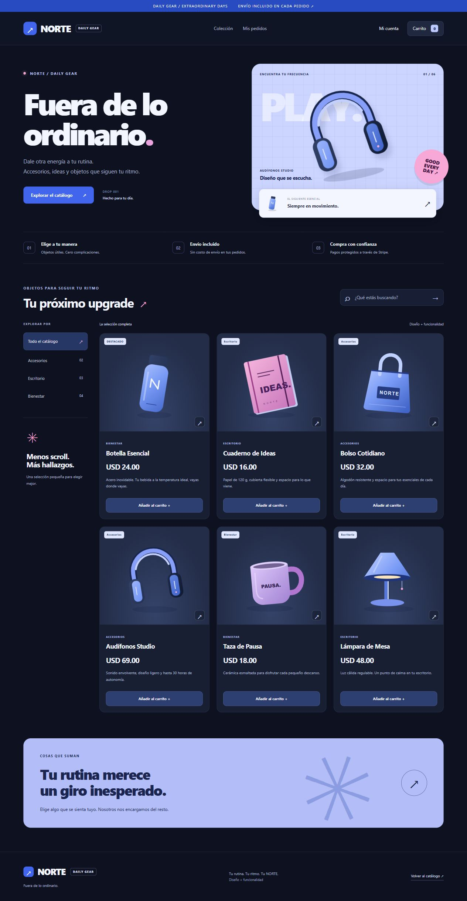
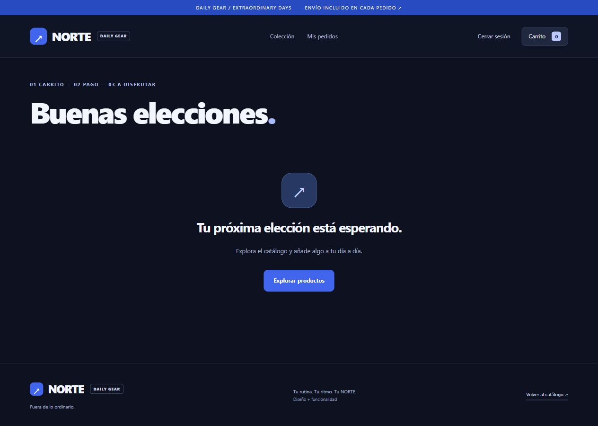
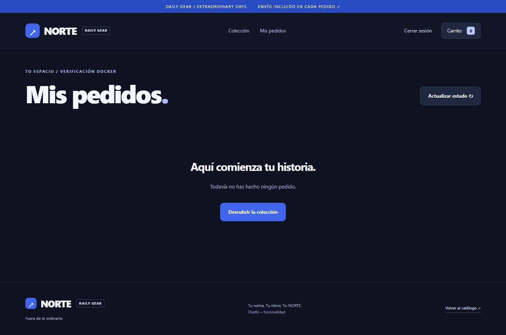

# Verificación del ecosistema Docker

Fecha local: 13 de noviembre de 2026 (Guatemala). Docker Engine 29.9.2, contenedores Linux.

Flujo verificado: navegador → Next.js 16 → Nginx → Laravel 12 / PHP-FPM 8.4 → MySQL 8.0 → respuesta renderizada.

## Resultados

| Comprobación | Resultado |
| --- | --- |
| `docker compose config --quiet` | Correcto |
| `docker compose up --build -d` | Imágenes construidas y servicios iniciados |
| Migraciones | `migrate` terminó con código 0; migración marcada Ran |
| Extensiones | pdo_mysql, mbstring, openssl, tokenizer, xml, ctype y json presentes |
| HTTP | /up, /api/products, /catalogo y /api/session respondieron 200 |
| API | 14 comprobaciones correctas en verificacion-api.json |
| Navegador | Seis productos, registro y acceso al historial protegido correctos |
| Consola del navegador | Sin errores capturados |
| Persistencia | Tras down/up se conservaron seis productos, tres usuarios, una orden y la sesión |
| MySQL | Volumen norte_mysql-data; sin puerto publicado al host |
| Caché | Reconstrucción sin cambios: 10,41 s; 35 pasos CACHED |

La API comprueba registro, login, protección de órdenes, recálculo de precios, idempotencia, validación, historial, aislamiento y revocación de token. Las cuentas utilizadas son sintéticas de QA y los correos pertenecen a example.com. No se ejecutaron pagos en Stripe en esta verificación.

## Tamaños medidos

Valores `.Size` de `docker image inspect`, en bytes; incluyen las capas de cada imagen y no son tamaños comprimidos de descarga.

| Imagen | Bytes |
| --- | ---: |
| norte-frontend:local | 707557371 |
| norte-api:local | 189819194 |
| norte-nginx:local | 92725604 |
| mysql:8.0 | 1085694697 |

No se dispone de una medición de una imagen anterior equivalente; por ello no se afirma un porcentaje de reducción. Los tiempos dependen del equipo, la red y la caché existente.

## Correcciones verificadas

- El paso de pnpm usa `CI=true` para evitar confirmaciones interactivas durante la eliminación de dependencias de desarrollo.
- El runtime de Laravel incluye `bootstrap/providers.php` para registrar AppServiceProvider y el limitador de intentos de autenticación.

## Evidencias

- [Contenedores](docker-contenedores.txt), [migraciones](docker-migraciones.txt), [extensiones](docker-extensiones.txt), [tamaños](docker-imagenes.txt).
- [Pruebas HTTP de la API](verificacion-api.json).
- Conteos MySQL antes y después: [antes](docker-conteos-antes.txt) / [después](docker-conteos-despues.txt). Primera línea: usuarios; segunda: órdenes.
- [Duración de la reconstrucción](docker-cache-tiempo.json).

### Catálogo servido desde MySQL

### Registro completado desde Next.js

### Historial autenticado tras recrear los contenedores

